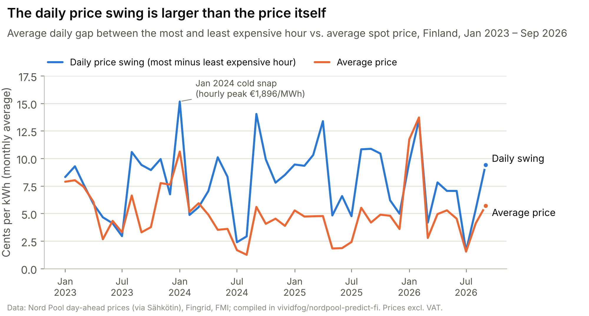
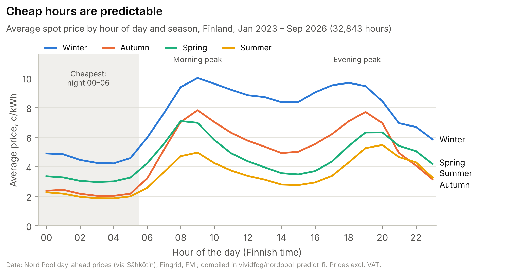
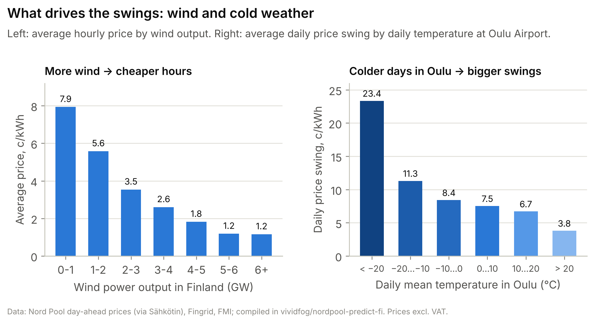
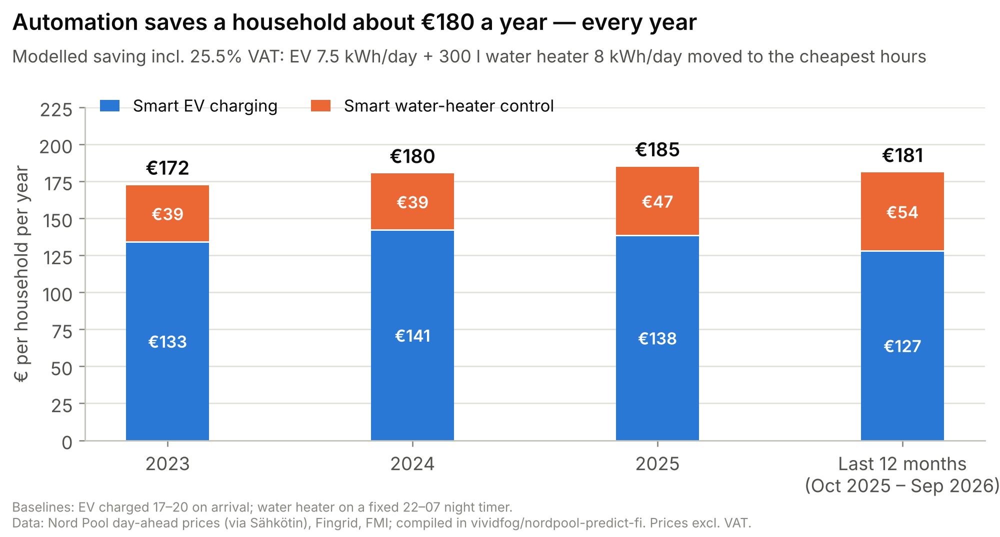
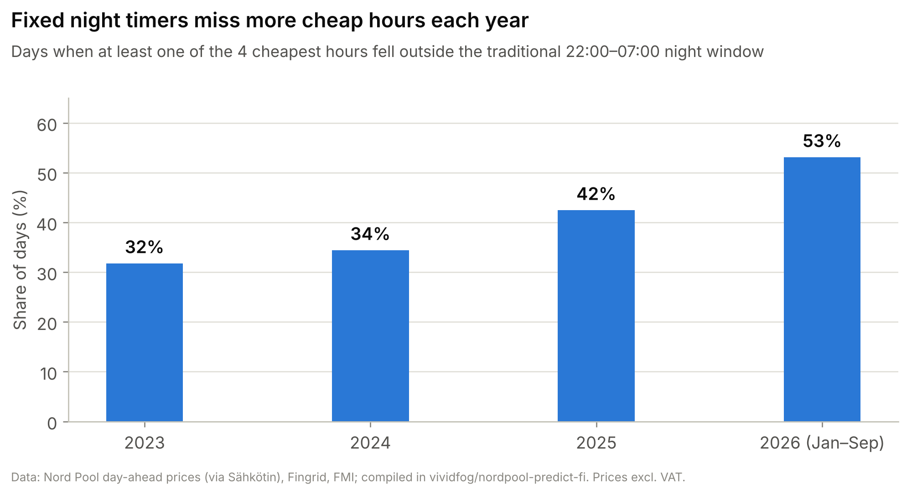

<div align="center">

# Turning Price Swings into Savings

### A data-driven feasibility study of a smart load-shifting service for Finnish households

[](https://www.python.org/)
[](https://pandas.pydata.org/)
[](analysis/Energy_Flexibility_Data_Analysis.xlsx)
[](#data)
[](LICENSE)

**University of Oulu · Data Analytics and Business Intelligence · 2026**

[Report (PDF)](report/Turning_Price_Swings_into_Savings_Report.pdf) ·
[Excel model](analysis/Energy_Flexibility_Data_Analysis.xlsx) ·
[Reproducible analysis](src/analysis.py) ·
[Dataset](data/processed/finland_hourly_spot_prices_2023-01_2026-09.csv)

</div>

---

## Overview

Since the 2022 energy crisis, roughly **one in three Finnish electricity contracts follows the hourly spot price**, the number of fully electric cars is growing fast, and Northern Ostrobothnia hosts over a third of Finland's wind capacity. Prices now move sharply *within* every day.

This project asks a single go/no-go business question:

> **Are Finnish spot-price swings large, persistent and predictable enough that an automated service shifting household loads (EV charging, water heating) to the cheapest hours would create meaningful value — starting in Oulu?**

**Answer: yes.** Across **32,853 hourly records (Jan 2023 – Sep 2026)** the average daily price swing (**7.8 c/kWh**) is larger than the average price itself (**5.0 c/kWh**). Cheap hours follow a stable rhythm that is published a day in advance, and a typical EV + water-heater household would save about **€180 a year — every year**. The recommendation is to take the idea forward as a **software-first service**.

<div align="center">

| 📊 Hourly records | 🗓️ Coverage | 💶 Household saving | 🚗 EV value pool |
|:---:|:---:|:---:|:---:|
| **32,853** | **45 months** | **≈ €180 / year** | **≈ €7 M / year** |
| prices, wind, nuclear, weather | Jan 2023 – Sep 2026 | EV + 300 l water heater | EV owners on spot contracts |

</div>

---

## The four feasibility tests

The opportunity was judged viable only if all four criteria were met.

| Test | Criterion | Evidence | Result |
|---|---|---|:---:|
| **Value** | Prices vary by several cents per kWh on a normal day | Average daily swing **7.8 c/kWh** vs. average price **5.0 c/kWh**; moving 1 kWh to the 4 cheapest hours saves **≈ 2.8 c** | ✅ |
| **Persistence** | The swing holds every year, not just during the energy crisis | Daily swing **7.35 → 8.06 → 8.48 → 7.22 c/kWh** (2023 → last 12 months) | ✅ |
| **Predictability** | Cheap hours are regular and known in advance | Cheapest hours fall between **00–06 in every season**; day-ahead prices are published the afternoon before | ✅ |
| **Customer benefit** | An average home saves around €15 per month | **€172 – €185 per year** per household in every period | ✅ |

---

## Key findings

### 1 · The daily price swing is larger than the price itself

The gap between the most and least expensive hour of the day is consistently larger than the average price — and it did not fade after the energy crisis; it peaked in 2025. The January 2024 cold snap pushed a single hour to **€1,896/MWh**.

<p align="center"></p>

### 2 · Cheap hours are predictable

Prices follow the same daily rhythm in every season: lowest between **00:00 and 06:00**, with a morning peak around 09:00 and an evening peak around 19:00. Because Nord Pool publishes day-ahead prices the previous afternoon, a scheduler can act on known prices rather than forecasts.

<p align="center"></p>

### 3 · Wind and cold weather drive the swings

Hours with **less than 1 GW of wind** averaged **7.9 c/kWh**, against **1.2 c/kWh above 5 GW** (r = −0.38). Days when Oulu dropped **below −20 °C** had an average swing of **23.4 c/kWh** — about three times a normal day.

<p align="center"></p>

### 4 · Automation saves a household about €180 a year — every year

A modelled Oulu household (EV charging 7.5 kWh/day + a 300-litre water heater using 8 kWh/day) saves **€172–€185 per year** by moving consumption to the cheapest hours instead of charging on arrival (17–20) and heating on a fixed 22–07 night timer. A 10 kWh home battery would earn only about **€250–300 a year** while costing thousands of euros, so a **hardware-free software service** is the better entry point.

<p align="center"></p>

### 5 · Fixed night timers are falling behind

The share of days on which at least one of the four cheapest hours falls **outside** the traditional 22:00–07:00 window rose from **32 % (2023) to 53 % (2026)**. Static timers capture less and less of the available saving — dynamic scheduling captures it.

<p align="center"></p>

---

## Key metrics by period

| Metric | 2023 | 2024 | 2025 | Last 12 months |
|---|---:|---:|---:|---:|
| Average price, c/kWh | 5.71 | 4.56 | 4.05 | 5.58 |
| Average daily swing, c/kWh | 7.35 | 8.06 | 8.48 | 7.22 |
| Negative-price hours | 457 | 726 | 465 | 104 |
| Saving per kWh shifted, c | 2.80 | 2.74 | 2.85 | 2.81 |
| Smart EV charging saving, €/year | 133 | 141 | 138 | 127 |
| Smart water-heater saving, €/year | 39 | 39 | 47 | 54 |
| **Household saving, €/year (incl. VAT)** | **172** | **180** | **185** | **181** |

<sub>Prices excl. VAT. Savings incl. 25.5 % VAT, applied to all years for comparability. "Last 12 months" = Oct 2025 – Sep 2026.</sub>

**Market size.** About **56,000** EV owners are on spot contracts today (33 % of 169,458 fully electric cars). Smart EV charging alone represents an indicative value pool of **≈ €7 million a year**, or **≈ €22 million** if all owners were on spot pricing.

---

## Data

| | |
|---|---|
| **Source** | Hourly dataset compiled in the open-source project [vividfog/nordpool-predict-fi](https://github.com/vividfog/nordpool-predict-fi) (MIT), file `data/dump.csv`, accessed 5 Oct 2026 |
| **Prices** | Nord Pool day-ahead, Finland (via the Sähkötin API) |
| **Generation** | Wind and nuclear output from Fingrid Open Data |
| **Weather** | Finnish Meteorological Institute, station 101786 Oulu Airport |
| **Coverage** | 1 Jan 2023 – 30 Sep 2026 · 45 complete months · 32,853 hours |

### Cleaning log

| Step | Records |
|---|---:|
| Raw hourly rows in source file | 33,384 |
| Removed forecast rows without an actual price | −170 |
| Removed incomplete October 2026 (keep 45 full months) | −361 |
| Duplicate timestamps / missing hours | 0 / 0 |
| Flagged and excluded bidding-error hours (24 Nov 2023, −500 €/MWh) | 10 |
| Negative wind readings set to 0 MW | 44 |
| Missing Oulu temperature hours filled by linear interpolation | 5 |
| **Final hourly records** (valid for price statistics) | **32,853** (32,843) |

Prices were converted to **excluding VAT** with the official rates in force at each time (10 % → 24 % → 25.5 %), and UTC timestamps were converted to Finnish local time (DST-aware). See [`data/README.md`](data/README.md) for the full data dictionary.

---

## Methodology

The methods are deliberately simple and transparent — suited to a go/no-go business decision rather than a forecasting exercise:

- **Descriptive statistics** of price level, daily swing (max − min hour), spikes and negative-price hours
- **Pivot-style aggregation** by day, month, year, hour of day and season
- **Banding and correlation** of prices against wind output and Oulu temperature
- **What-if household simulation** comparing fixed schedules with smart scheduling:

| Load | Baseline | Smart schedule | Energy |
|---|---|---|---|
| EV charging | Charge on arrival, 17:00–19:59 | Cheapest 3 h between 17:00 and 06:59 | 7.5 kWh/day |
| Water heater | Fixed night timer, 22:00–06:59 | Cheapest 4 h of the day | 8 kWh/day |
| Home battery (comparison) | — | Charge in 3 cheapest h, discharge in 3 dearest h, 90 % efficiency | 10 kWh |

**Tools.** Python (pandas) for loading, cleaning and per-day cheapest-hour selection; **Excel formulas** for every summary, pivot and saving in the workbook, so all results recalculate when an assumption on the `Assumptions` sheet is changed. The [`src/analysis.py`](src/analysis.py) script independently reproduces all headline numbers from the cleaned CSV.

---

## Reproduce the analysis

```bash
git clone https://github.com/Imran5002/finland-spot-price-load-shifting.git
cd finland-spot-price-load-shifting
pip install -r requirements.txt
python src/analysis.py
```

The script prints the key metrics and writes the result tables to [`results/`](results/):

```text
Key metrics by period (Table 1 / Figures 4–5)
                avg_price_c_kwh  avg_daily_swing_c_kwh  negative_price_hours  ...  household_saving_eur
period
2023                       5.71                   7.35                   457  ...                172.19
2024                       4.56                   8.06                   726  ...                180.30
2025                       4.05                   8.48                   465  ...                184.50
2026 (Jan–Sep)             5.97                   7.22                    52  ...                134.94
Last 12 months             5.58                   7.22                   104  ...                180.96
```

---

## Repository structure

```text
finland-spot-price-load-shifting/
├── analysis/
│   └── Energy_Flexibility_Data_Analysis.xlsx   # Formula-driven Excel model (10 sheets)
├── data/
│   ├── README.md                               # Data dictionary and provenance
│   └── processed/
│       └── finland_hourly_spot_prices_2023-01_2026-09.csv
├── figures/                                    # Charts used in the report and presentation
├── report/
│   └── Turning_Price_Swings_into_Savings_Report.pdf
├── results/                                    # Tables generated by src/analysis.py
├── src/
│   └── analysis.py                             # Reproducible analysis pipeline
├── CITATION.cff
├── LICENSE
├── README.md
└── requirements.txt
```

### Excel workbook guide

| Sheet | Contents |
|---|---|
| `README` | Question, sources, units, colour code and cleaning log |
| `Assumptions` | Editable household and market inputs with sources |
| `Hourly_Data` | 32,853 cleaned hourly records |
| `Daily_Metrics` | 1,369 days: price statistics, swing and cheapest-hour savings |
| `Monthly_Summary` | 45 months of KPIs with trend chart |
| `Yearly_Summary` | KPIs per year and for the last 12 months |
| `Hour_Patterns` | Hour × month heatmap and hour × season profile |
| `Drivers` | Price vs. wind bands, swing vs. Oulu temperature, correlations |
| `Household_Value` | Annual household savings, battery comparison, value pool |
| `Charts` | Final figures used in the report and presentation |

---

## Limitations and risks

- **Small absolute savings.** About €15 a month means the service must be cheap and simple enough to beat utility apps and DIY tools.
- **Flexibility is getting crowded.** Negative-price hours fell from 726 (2024) to 52 (Jan–Sep 2026) as batteries and other flexible loads absorb surplus wind.
- **Addressable market.** Only about one-third of contracts are tied to the spot price.
- **Model assumptions.** Savings depend on the stated household consumption profile.
- **Data provenance.** The compiled dataset comes from a hobby project; spot checks agreed with recorded market events. Since October 2025, 15-minute prices are averaged to hourly values.

**Next step:** a small willingness-to-pay study among Oulu households with EVs and electric heating.

---

## References

- Bloomberg (2023, 23 Nov). *Trader error causes huge plunge in Finnish power prices.*
- Korhonen, A. (2025, 10 Jul). *Joka kolmas käyttää pörssisähköä* [One in three uses spot-price electricity]. Verkkouutiset.
- Renewables Finland (2026, 8 Jan). *More than 1,000 megawatts of new wind power built in Finland.*
- Statistics Finland (2025, 15 Apr). *Number of kilometres driven with cars in 2024 unchanged from the year before.*
- Statistics Finland (2026, 2 Mar). *Finnish vehicle stock grew in 2025.*
- vividfog (2026). *nordpool-predict-fi: data/dump.csv* [Data set]. GitHub.

Full references with links are in the [report](report/Turning_Price_Swings_into_Savings_Report.pdf).

---

## Author

**Mehedi Hasan Imran** — Business Analytics, University of Oulu

Course project for *Data Analytics and Business Intelligence* (2026).

## License

Code is released under the [MIT License](LICENSE). The report, Excel workbook and figures are © 2026 Mehedi Hasan Imran. The underlying data comes from [vividfog/nordpool-predict-fi](https://github.com/vividfog/nordpool-predict-fi) (MIT) and its original providers — Nord Pool, Fingrid and the Finnish Meteorological Institute — under their respective terms.
